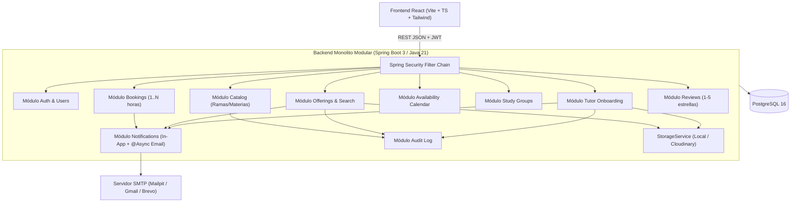
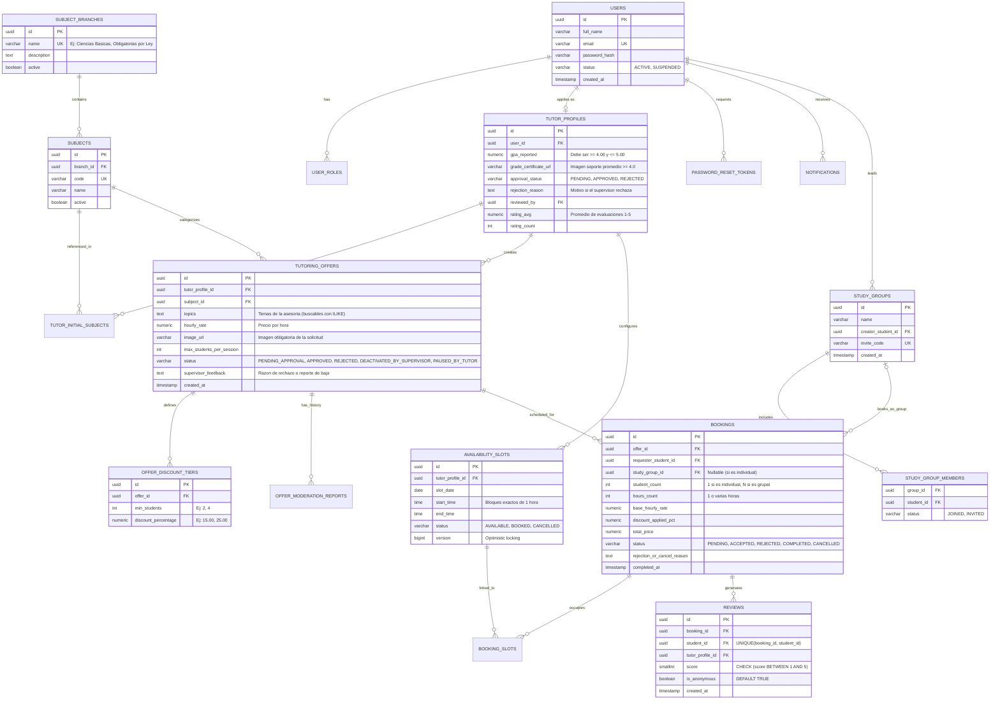

# Plan de Implementación — MVP Plataforma de Tutorías entre Pares (Polink)

> [!IMPORTANT]
> Este plan consolida todas las decisiones arquitectónicas, reglas de negocio, asunciones validadas y requisitos técnicos acordados durante la sesión de diseño para el MVP de **Polink**.

---

## 1. Decisiones Arquitectónicas y Reglas de Negocio Acordadas

### 1.1 Roles, Seguridad y Moderación
- **Autenticación y Sesiones:** Spring Security 6 + JWT (`accessToken` + `refreshToken` opcional o expiración controlada) y flujo de recuperación de contraseña mediante token temporal de un solo uso (expiración de 30 minutos) enviado por correo.
- **Modelo de Cuentas y Roles Acumulables (`STUDENT` y `TUTOR`):**
  - Existen formularios de registro diferenciados para **Estudiante** y para **Asesor**.
  - Toda cuenta registrada como Asesor posee también el rol base `ROLE_STUDENT` (puede buscar y agendar asesorías como estudiante inmediatamente, incluso mientras su perfil de asesor está en estado `PENDING_REVIEW`).
  - Un Estudiante ya registrado también puede postularse posteriormente para habilitar su perfil de Asesor subiendo su evidencia de promedio $\ge 4.0$ (sobre $5.0$) y eligiendo al menos una materia inicial del catálogo.
- **Rol `SUPERVISOR`:**
  1. **Revisión de Registro de Asesores:** Aprueba o rechaza las solicitudes de perfil de asesor tras verificar manualmente la imagen del certificado/historial académico (promedio $\ge 4.0/5.0$). Si rechaza, debe ingresar un motivo obligatorio.
  2. **Revisión de Solicitudes de Ofertas de Asesoría:** Aprueba o rechaza las ofertas creadas por asesores activos (con motivo obligatorio al rechazar).
  3. **Baja de Asesorías Activas:** Puede dar de baja (`DEACTIVATED_BY_SUPERVISOR`) cualquier oferta de asesoría publicada, generando un **reporte obligatorio** con la causa, el cual se notifica al asesor por correo e in-app.
- **Rol `ADMIN` (Acotado + Auditoría):**
  - Gestiona el **Catálogo de Ramas y Materias** (`subject_branches` y `subjects`).
  - Crea, activa o desactiva cuentas de **Supervisores** y puede suspender cuentas por uso indebido.
  - **Restricción de seguridad:** No modifica reservas, precios pactados ni reseñas de usuarios, y respeta el anonimato de las evaluaciones. Toda acción de un `ADMIN` o `SUPERVISOR` queda registrada en una tabla inmutable `audit_logs`.

### 1.2 Catálogo de Materias y Ofertas de Asesoría
- **Catálogo Cerrado en BD:** Las materias pertenecen a una **Rama** (ej. *Ciencias Básicas*, *Obligatorias por Ley*, *Ingeniería Aplicada*) y solo pueden seleccionarse desde la tabla `subjects` (nunca texto libre).
- **Libertad supervisada al ofertar:** Las materias seleccionadas por el asesor en su registro sirven como referencia inicial; una vez aprobado como asesor, al crear una solicitud de oferta de asesoría puede elegir **cualquier materia activa del catálogo**, ya que cada oferta individual requiere aprobación de un supervisor.
- **Datos de la Oferta de Asesoría:** Materia (`subject_id`), temas cubiertos (`topics`), precio por hora por estudiante (`hourly_rate`), imagen adjunta (`image_url`), cupo máximo opcional y tramos de descuento para grupos de estudio.

### 1.3 Búsqueda, Calendario, Grupos de Estudio y Evaluaciones
- **Motor de Búsqueda:** Consulta SQL mediante `ILIKE '%keyword%'` sobre los temas de la oferta (`tutoring_offers.topics`) y el nombre de la asignatura (`subjects.name`), filtrando únicamente ofertas en estado `APPROVED`.
- **Calendario Global por Asesor y Bloqueo de Disponibilidad:**
  - El calendario pertenece al **Asesor** (compartido entre todas las materias que oferte) y se divide en bloques de **1 hora** (`availability_slots`), con opción de repetir bloques semanalmente.
  - Un estudiante (o grupo) puede solicitar agendar **1 o varias horas** sobre bloques `AVAILABLE`.
  - Varios estudiantes pueden enviar solicitud sobre un mismo bloque libre (`PENDING`), pero **en cuanto el asesor acepta una solicitud**, esos bloques de 1 hora pasan a estado `BOOKED` (protegido contra condiciones de carrera con bloqueo en BD) y cualquier otra solicitud `PENDING` que se solape en ese horario se **rechaza automáticamente** notificando a los solicitantes.
- **Grupos de Estudio y Descuentos Automáticos:**
  - Los estudiantes pueden crear un **Grupo de Estudio**, invitar a otros estudiantes (por correo/usuario o código de invitación) y solicitar una asesoría seleccionando el grupo.
  - El asesor configura tramos de descuento en su oferta (ej. `2 a 3 estudiantes -> 15%`, `4 o más -> 25%`). El sistema aplica automáticamente el porcentaje correspondiente según la cantidad de miembros confirmados en la reserva grupal.
- **Cierre Manual y Evaluación Anónima (1 a 5):**
  - El asesor finaliza manualmente la sesión haciendo clic en **"Finalizar asesoría"** (estado `COMPLETED`).
  - Al pasar a `COMPLETED`, se habilita para el estudiante (o para cada miembro del grupo de estudio) la evaluación numérica de **1 a 5 estrellas** (sin comentario de texto).
  - La evaluación es **anónima por defecto** (`is_anonymous = true`), a menos que el estudiante marque explícitamente que desea mostrar su nombre.

### 1.4 Notificaciones e Infraestructura Costo ~$0
- **Notificaciones In-App:** **Polling ligero inteligente** desde React cada **45–60 segundos** (activo únicamente cuando la pestaña está visible mediante `document.visibilityState === 'visible'`) más actualización inmediata tras acciones del usuario.
- **Notificaciones por Correo:** Envío asíncrono (`@Async` en Spring Boot con `JavaMailSender`) usando **Mailpit** en entorno local (Docker) y **SMTP gratuito** (Gmail App Password / Brevo Free Tier) en despliegue.
- **Almacenamiento de Imágenes:** Interfaz `StorageService` con implementación `LocalFileStorageService` (carpeta `./uploads` en local) y `CloudinaryStorageService` (capa gratuita en producción).

---

## 2. Arquitectura del Monolito Modular, Encarpetado por Funcionalidad/Capas y Estándares

### 2.1 Estándares de Desarrollo, Contrato de API y Swagger
- **Organización por Funcionalidad y Capas Internas (Feature + Layered Architecture):**
  - Tanto en **Backend** como en **Frontend**, existirá **una carpeta por cada funcionalidad (módulo de dominio)** y, dentro de cada funcionalidad, **subcarpetas por cada capa arquitectónica**:
    - En cada módulo del Backend (`auth`, `user`, `catalog`, `tutor`, `offering`, `availability`, `studygroup`, `booking`, `review`, `notification`, `audit`):
      - `controller/` (Endpoints REST documentados con anotaciones de Swagger/OpenAPI)
      - `service/` (Reglas de negocio y transacciones)
      - `repository/` (Interfaces Spring Data JPA / consultas SQL)
      - `entity/` (Entidades JPA mapeadas a PostgreSQL)
      - `dto/` (Records/Clases de Request y Response con validaciones Jakarta)
    - En cada módulo del Frontend (`src/features/<funcionalidad>/`):
      - `pages/` (Vistas principales de la funcionalidad)
      - `components/` (Componentes UI propios del módulo)
      - `services/` (Llamadas HTTP a los endpoints del módulo)
      - `hooks/` (Custom hooks de estado/lógica de la funcionalidad)
      - `types/` (Interfaces y tipos TypeScript del dominio)
- **Contrato de API Vivo (`API_CONTRACT.md`):**
  - Se creará en la raíz del proyecto el archivo `API_CONTRACT.md`, el cual se actualizará en cada fase con la especificación detallada de todos los endpoints (Método HTTP, URL, Roles autorizados, Headers, Request Body/Params, Response JSON y Códigos HTTP).
- **Documentación Interactiva con Swagger / OpenAPI 3:**
  - Se integrará `springdoc-openapi-starter-webmvc-ui` en Spring Boot (accesible en `/swagger-ui.html` y `/v3/api-docs`), configurado con soporte para autenticación **Bearer JWT** para probar todos los endpoints desde el navegador.
- **Regla Estricta sobre Comentarios en el Código:**
  - **Evitar comentarios en el código** (tanto en Java como en TypeScript/React y SQL). El código debe ser auto-explicativo mediante nombres semánticos claros; **únicamente se incluirán comentarios breves en bloques de lógica muy pesada o crítica** (como el bloqueo transaccional de slots y rechazo automático de reservas solapadas o el cálculo de precios grupales por tramos).
- **Seguridad del Proyecto, Variables de Entorno y `.gitignore` Anticipado:**
  - **Lo primero que debe ejecutarse al iniciar el proyecto** es la creación de `.gitignore`, las plantillas de variables de entorno (`.env.example` y `.env` local) y la actualización de `README.md`.
  - **Prohibición de secretos en código (*Zero Hardcoded Secrets*):** Ninguna contraseña, llave privada JWT, credencial SMTP, API key de Cloudinary o contraseña de usuarios semilla podrá estar quemada en el código ni en archivos versionados. Todo valor sensible debe inyectarse por variables de entorno.
  - **Archivos y carpetas anticipados que obligatoriamente deben estar en `.gitignore`:**
    - **Variables de entorno y secretos:** `.env`, `.env.*`, `!.env.example`, `backend/.env*`, `frontend/.env*`, `!frontend/.env.example`, `application-local.yml`, `application-secret*.yml`, `*.pem`, `*.key`, `*.p12`, `*.jks`, `secrets.*`, `credentials.json`.
    - **Archivos subidos por usuarios y volúmenes de BD:** `uploads/`, `backend/uploads/`, `pgdata/`, `postgres-data/`, `*.db`, `*.sqlite`, `*.dump`, `*.sql.gz`.
    - **Artefactos de compilación Backend (Maven / Java / Spring Boot):** `target/`, `*.class`, `*.jar`, `*.war`, `*.ear`, `!.mvn/wrapper/maven-wrapper.jar`, `hs_err_pid*`, `replay_pid*`.
    - **Artefactos Frontend (Node / Vite / React / TypeScript):** `node_modules/`, `dist/`, `dist-ssr/`, `build/`, `.vite/`, `.eslintcache`, `*.tsbuildinfo`, `npm-debug.log*`, `yarn-debug.log*`, `pnpm-debug.log*`.
    - **IDEs, Editores y Sistema Operativo:** `.idea/`, `*.iml`, `.vscode/`, `.settings/`, `.project`, `.classpath`, `.factorypath`, `.DS_Store`, `Thumbs.db`, `Desktop.ini`.
    - **Logs, cobertura de pruebas y temporales:** `logs/`, `*.log`, `coverage/`, `.nyc_output/`, `tmp/`, `temp/`, `*.bak`, `*.swp`, `*.swo`.

### 2.2 Estructura del Repositorio

El repositorio (`Polink/`) contendrá el backend, el frontend, las plantillas de variables de entorno, el `.gitignore`, el contrato de API y la infraestructura local:

```text
Polink/
├── .gitignore                  # Reglas anticipadas de exclusión para secretos, builds, uploads, IDEs y volúmenes
├── .env.example                # Plantilla versionada de variables de entorno para Docker Compose y Backend
├── .env                        # Variables de entorno locales (IGNORADO EN GIT)
├── docker-compose.yml          # PostgreSQL 16 + Mailpit (configurados mediante variables de .env)
├── API_CONTRACT.md             # Documento vivo con el contrato detallado de todos los endpoints REST
├── README.md                   # Documentación de arquitectura, configuración de .env, ejecución y seguridad
├── backend/                    # Spring Boot 3.x (Java 21, Maven, Flyway, Spring Security + JWT, Swagger/OpenAPI)
│   ├── pom.xml
│   └── src/main/
│       ├── java/com/polink/
│       │   ├── PolinkApplication.java
│       │   ├── common/
│       │   │   ├── config/     # SecurityConfig, OpenApiSwaggerConfig, AsyncConfig, CorsConfig
│       │   │   ├── exception/  # GlobalExceptionHandler, excepciones de dominio
│       │   │   ├── security/   # JwtService, JwtAuthenticationFilter, CurrentUser
│       │   │   └── storage/    # StorageService, LocalFileStorageService, CloudinaryStorageService
│       │   ├── auth/
│       │   │   ├── controller/
│       │   │   ├── service/
│       │   │   ├── repository/
│       │   │   ├── entity/
│       │   │   └── dto/
│       │   ├── user/
│       │   │   ├── controller/
│       │   │   ├── service/
│       │   │   ├── repository/
│       │   │   ├── entity/
│       │   │   └── dto/
│       │   ├── catalog/        # Ramas y Materias (controller, service, repository, entity, dto)
│       │   ├── tutor/          # Onboarding y revisión de Asesores (controller, service, repository, entity, dto)
│       │   ├── offering/       # Ofertas, descuentos, búsqueda ILIKE y moderación (controller, service, repository, entity, dto)
│       │   ├── availability/   # Calendario de disponibilidad por bloques de 1h (controller, service, repository, entity, dto)
│       │   ├── studygroup/     # Grupos de estudio entre estudiantes (controller, service, repository, entity, dto)
│       │   ├── booking/        # Reservas 1..N horas, aceptación y cierre manual (controller, service, repository, entity, dto)
│       │   ├── review/         # Evaluaciones 1-5 anónimas por defecto (controller, service, repository, entity, dto)
│       │   ├── notification/   # Notificaciones In-App + Email asíncrono (controller, service, repository, entity, dto)
│       │   └── audit/          # Logs de auditoría de Admin/Supervisor (controller, service, repository, entity, dto)
│       └── resources/
│           ├── application.yml
│           └── db/migration/   # Scripts SQL versionados con Flyway
└── frontend/                   # React 18 + Vite + TypeScript + TailwindCSS
    ├── .env.example            # Plantilla versionada de variables de entorno de Vite (VITE_API_BASE_URL, etc.)
    ├── .env                    # Variables de entorno locales del frontend (IGNORADO EN GIT)
    ├── package.json
    └── src/
        ├── core/               # Cliente Axios, AuthContext, NotificationPollingContext, componentes UI compartidos
        └── features/           # Una carpeta por funcionalidad, dividida en capas internas (pages, components, services, hooks, types)
            ├── auth/
            ├── catalog/
            ├── tutor-onboarding/
            ├── offerings/
            ├── availability/
            ├── study-groups/
            ├── bookings/
            ├── reviews/
            ├── notifications/
            ├── moderation/
            └── admin/
```

### Diagrama de Módulos y Flujo de Dependencias



---

## 3. Modelo de Base de Datos Relacional (PostgreSQL)



---

## 4. Casos de Uso y Flujos Críticos Detallados

### 4.1 Registro y Moderación de Asesores
1. **Registro Estudiante (`POST /api/v1/auth/register/student`):** Crea usuario activo con `ROLE_STUDENT`.
2. **Registro Asesor (`POST /api/v1/auth/register/tutor` - `multipart/form-data`):**
   - Recibe datos de cuenta, `gpaReported` (validado $\ge 4.0$ y $\le 5.0$), lista de `subjectIds` (al menos 1 del catálogo) y archivo de imagen `gradeCertificate`.
   - Crea el usuario con `ROLE_STUDENT` activo inmediatamente + `TutorProfile` en estado `PENDING`.
   - Dispara notificación In-App y correo a los Supervisores.
3. **Revisión por Supervisor (`PATCH /api/v1/supervisor/tutor-applications/{id}`):**
   - Si **Aprueba**: `TutorProfile.approvalStatus = APPROVED`, se asigna `ROLE_TUTOR` al usuario y se le notifica por correo e In-App.
   - Si **Rechaza**: Exige `reason` no vacío, guarda el motivo, mantiene al usuario solo como `ROLE_STUDENT` y le notifica el motivo por correo e In-App (permitiéndole corregir y reenviar su solicitud).

### 4.2 Solicitudes de Ofertas de Asesoría y Baja por Supervisor
1. **Creación de Solicitud de Oferta (`POST /api/v1/tutor/offers` - `multipart/form-data`):**
   - El asesor aprobado elige una `subjectId` del catálogo, describe los `topics`, define `hourlyRate`, adjunta la `image` obligatoria y opcionalmente define tramos de descuento (`discountTiers`) para grupos.
   - Nace en estado `PENDING_APPROVAL`.
2. **Aprobación / Rechazo de Solicitud (`PATCH /api/v1/supervisor/offers/{id}/review`):**
   - El supervisor aprueba (`APPROVED`, pasa a ser visible en el buscador) o rechaza (`REJECTED`, con motivo obligatorio enviado por correo e In-App al asesor).
3. **Dar de Baja una Asesoría Activa (`POST /api/v1/supervisor/offers/{id}/deactivate`):**
   - El supervisor visualiza todas las ofertas `APPROVED` y puede darlas de baja adjuntando un **reporte obligatorio** (`reportReason`).
   - La oferta pasa a `DEACTIVATED_BY_SUPERVISOR`, deja de aparecer en búsquedas, se guarda en `offer_moderation_reports` + `audit_logs` y se notifica al asesor.

### 4.3 Disponibilidad, Agendamiento de 1..N Horas y Grupos de Estudio
1. **Configuración de Disponibilidad (`POST /api/v1/tutor/availability`):**
   - El asesor selecciona bloques de 1 hora en su calendario (con opción `repeatWeeks: 1..12` para generar automáticamente los bloques de las próximas semanas).
   - Restricción única en BD: `UNIQUE (tutor_profile_id, slot_date, start_time)`.
2. **Creación de Grupo de Estudio (`POST /api/v1/study-groups`):**
   - Un estudiante crea un grupo y comparte el código de invitación o agrega compañeros por correo institucional/registrado.
3. **Solicitud de Reserva (`POST /api/v1/bookings`):**
   - El estudiante selecciona la oferta de asesoría, elige **1 o varios bloques de 1 hora disponibles** (`slotIds`) y opcionalmente elige uno de sus **Grupos de Estudio** (`studyGroupId`).
   - El backend calcula:
     $$\text{Total} = (\text{PrecioHora} \times \text{Horas} \times \text{NumEstudiantes}) \times \left(1 - \frac{\text{DescuentoTramo}}{100}\right)$$
   - La reserva se crea en estado `PENDING` y notifica al asesor.
4. **Aceptación y Bloqueo Automático (`PATCH /api/v1/tutor/bookings/{id}/accept`):**
   - Dentro de una transacción `@Transactional`:
     - Verifica que todos los `availability_slots` solicitados sigan en estado `AVAILABLE`.
     - Cambia esos `availability_slots` a `BOOKED` (reflejando inmediatamente en el calendario global del asesor que ya no está disponible en esas horas).
     - Cambia la reserva aceptada a `ACCEPTED`.
     - Busca todas las demás reservas en estado `PENDING` que compartan cualquiera de esos `slot_id`, las pasa a `REJECTED` con motivo *"El horario fue asignado a otra solicitud"* y envía notificación a los estudiantes correspondientes.

### 4.4 Finalización Manual y Evaluación (1 a 5, Anónima por Defecto)
1. **Finalización Manual (`PATCH /api/v1/tutor/bookings/{id}/complete`):**
   - El asesor marca la sesión `ACCEPTED` como `COMPLETED`.
   - Se envía notificación al estudiante (o a todos los miembros del grupo de estudio) invitándolos a calificar la sesión.
2. **Evaluación (`POST /api/v1/bookings/{id}/reviews`):**
   - Solo permitida si `booking.status == COMPLETED` y el usuario autenticado fue el estudiante solicitante o miembro del grupo de estudio de esa reserva.
   - Recibe `score` ($1 \dots 5$) e `isAnonymous` (`true` por defecto).
   - Al consultar las reseñas de un asesor (`GET /api/v1/tutors/{id}/reviews`), el DTO devuelve `reviewerName: "Estudiante Anónimo"` siempre que `isAnonymous == true`.

---

## 5. Fases de Implementación Detalladas (Especificación para Agentes de Código)

> [!IMPORTANT]
> **Reglas Globales Obligatorias para el Agente Ejecutor de Cualquier Fase:**
> 1. **Seguridad del Proyecto, Variables de Entorno y `.gitignore` Siempre Presentes:**
>    - **Ningún agente puede quemar (*hardcodear*) secretos**, contraseñas de BD, claves JWT (`JWT_SECRET`), credenciales SMTP, API keys de Cloudinary o contraseñas de usuarios en el código fuente, `application.yml` o scripts SQL. Todo secreto debe leerse desde variables de entorno.
>    - **Revisión obligatoria de `.gitignore` en cada fase:** Si un agente introduce un nuevo tipo de archivo temporal, carpeta de subida de archivos, caché de compilación o variable de entorno, **debe** actualizar `.gitignore` y `.env.example` antes de hacer commit o cerrar su fase, verificando con `git status` que ningún archivo sensible o binario quede expuesto.
> 2. **Arquitectura por Funcionalidad + Capas Internas:** Todo código debe ubicarse en su módulo de dominio (`com.polink.<modulo>.{controller,service,repository,entity,dto}` en Backend y `src/features/<modulo>/{pages,components,services,hooks,types}` en Frontend).
> 3. **Cero Comentarios Triviales:** No escribir comentarios en el código salvo en bloques de lógica transaccional o algorítmica muy pesada.
> 4. **Actualización de `API_CONTRACT.md`:** Cada agente que cree o modifique un endpoint **debe** documentarlo inmediatamente en `/API_CONTRACT.md` (Método, Ruta, Rol requerido, Request JSON/Multipart, Response JSON, Códigos de estado).
> 5. **Swagger / OpenAPI 3:** Todo `Controller` y `DTO` debe incluir anotaciones de `io.swagger.v3.oas.annotations` (`@Tag`, `@Operation`, `@ApiResponses`, `@SecurityRequirement(name = "bearerAuth")`, `@Schema`).
> 6. **Pruebas Unitarias y Verificación Funcional Obligatoria en Cada Fase:**
>    - Cada agente debe implementar pruebas unitarias (`JUnit 5` + `Mockito` + `MockMvc` en `backend/src/test/java/com/polink/<modulo>/` y `Vitest` + `React Testing Library` en Frontend) cubriendo casos de éxito, validaciones de negocio y manejo de excepciones para todos los servicios, validadores y controladores de su fase.
>    - Ninguna fase se considera terminada hasta que `./mvnw test` (o `npm test`) finalice con **0 fallos y 0 errores** (`BUILD SUCCESS`).

---

### Fase 1: Variables de Entorno, `.gitignore`, `README.md`, Cimientos, Esquema BD, Almacenamiento, Auditoría y Notificaciones

- **Responsable:** Agente 1 (Seguridad Inicial, Infraestructura y Core Backend)
- **Dependencias previas:** Ninguna.
- **Objetivo:** Ejecutar **como primer paso absoluto** la creación de `.gitignore`, las variables de entorno (`.env.example` / `.env`) y la actualización de `README.md`; posteriormente dejar operativo el esqueleto del proyecto (`backend/`, `frontend/`, `docker-compose.yml`, `API_CONTRACT.md`), las migraciones Flyway completas, el manejo global de errores, Swagger UI, almacenamiento de archivos (`StorageService`), registro de auditoría (`audit`), sistema de notificaciones (`notification`) y su batería de pruebas unitarias.

#### Archivos y Capas a Implementar
0. **Paso 0 (Prioridad Inicial Absoluta — Seguridad, `.gitignore`, Variables de Entorno y `README.md`):**
   - `.gitignore` (en la raíz `Polink/`): Incluir de forma anticipada todas las reglas para:
     - Archivos de entorno y secretos: `.env`, `.env.*`, `!.env.example`, `backend/.env*`, `frontend/.env*`, `!frontend/.env.example`, `application-local.yml`, `application-secret*.yml`, `*.pem`, `*.key`, `*.p12`, `*.jks`, `secrets.*`, `credentials.json`.
     - Archivos subidos y datos locales: `uploads/`, `backend/uploads/`, `pgdata/`, `postgres-data/`, `*.db`, `*.sqlite`, `*.dump`, `*.sql.gz`.
     - Backend Java/Maven: `target/`, `*.class`, `*.jar`, `*.war`, `*.ear`, `!.mvn/wrapper/maven-wrapper.jar`, `hs_err_pid*`, `replay_pid*`.
     - Frontend Node/Vite/TS: `node_modules/`, `dist/`, `dist-ssr/`, `build/`, `.vite/`, `.eslintcache`, `*.tsbuildinfo`, `npm-debug.log*`, `yarn-debug.log*`, `pnpm-debug.log*`.
     - IDEs y SO: `.idea/`, `*.iml`, `.vscode/`, `.settings/`, `.project`, `.classpath`, `.factorypath`, `.DS_Store`, `Thumbs.db`, `Desktop.ini`.
     - Logs y temporales: `logs/`, `*.log`, `coverage/`, `.nyc_output/`, `tmp/`, `temp/`, `*.bak`, `*.swp`, `*.swo`.
   - `.env.example` y `.env` (en raíz `Polink/`) + `frontend/.env.example` y `frontend/.env`:
     - Definir todas las variables del proyecto (`POSTGRES_DB`, `POSTGRES_USER`, `POSTGRES_PASSWORD`, `POSTGRES_PORT`, `DB_URL`, `JWT_SECRET`, `JWT_EXPIRATION_MS`, `PASSWORD_RESET_EXPIRATION_MINUTES`, `FRONTEND_BASE_URL`, `CORS_ALLOWED_ORIGINS`, `MAIL_HOST`, `MAIL_PORT`, `MAIL_USERNAME`, `MAIL_PASSWORD`, `MAIL_FROM`, `STORAGE_PROVIDER`, `STORAGE_LOCAL_DIR`, `CLOUDINARY_CLOUD_NAME`, `CLOUDINARY_API_KEY`, `CLOUDINARY_API_SECRET`, `VITE_API_BASE_URL`, `VITE_NOTIFICATION_POLL_INTERVAL_MS`).
   - `README.md`: Actualizar con descripción del proyecto Polink, stack tecnológico, estructura por funcionalidad y capas, instrucciones paso a paso para copiar `.env.example` a `.env`, levantar Docker Compose, ejecutar Backend y Frontend, URLs de Swagger UI y Mailpit, y lineamientos de seguridad.
1. **Raíz del Repositorio (`Polink/`):**
   - `docker-compose.yml`: Servicios `postgres:16-alpine` (puerto `${POSTGRES_PORT:-5432}`, BD `${POSTGRES_DB}`, usuario `${POSTGRES_USER}`, password `${POSTGRES_PASSWORD}`) y `axllent/mailpit` (SMTP `1025`, Web UI `8025`).
   - `API_CONTRACT.md`: Plantilla estructurada por módulos con convenciones de respuesta de error estándar (`ApiErrorResponse`) y endpoints de Fase 1 (`notification`, `audit`).
2. **Configuración Backend (`backend/`):**
   - `pom.xml`: Java 21, Spring Boot 3.3+, `spring-boot-starter-web`, `spring-boot-starter-data-jpa`, `spring-boot-starter-security`, `spring-boot-starter-validation`, `spring-boot-starter-mail`, `flyway-core`, `flyway-database-postgresql`, `postgresql`, `jjwt-api/impl/jackson` (0.12.x), `springdoc-openapi-starter-webmvc-ui` (2.6.x), `cloudinary-http44`, `lombok`.
   - `src/main/resources/application.yml`: Configuración estrictamente parametrizada con variables de entorno (`${DB_URL}`, `${POSTGRES_USER}`, `${POSTGRES_PASSWORD}`, `${JWT_SECRET}`, etc.).
   - `src/main/resources/db/migration/V1__init_schema.sql`: Creación de todas las tablas del diagrama ER (`users`, `roles`, `user_roles`, `password_reset_tokens`, `subject_branches`, `subjects`, `tutor_profiles`, `tutor_initial_subjects`, `tutoring_offers`, `offer_discount_tiers`, `offer_moderation_reports`, `availability_slots`, `study_groups`, `study_group_members`, `bookings`, `booking_slots`, `reviews`, `notifications`, `audit_logs`) con sus llaves foráneas, `CHECK` constraints (`gpa_reported >= 4.00 AND gpa_reported <= 5.00`, `score BETWEEN 1 AND 5`) e índices.
   - `src/main/resources/db/migration/V2__seed_catalog_and_roles.sql`: Inserción de roles (`ROLE_STUDENT`, `ROLE_TUTOR`, `ROLE_SUPERVISOR`, `ROLE_ADMIN`), 4 ramas iniciales y 12 materias base. (La creación del usuario `ADMIN` y `SUPERVISOR` inicial se hará mediante un `ApplicationRunner` que lea `SEED_ADMIN_EMAIL` / `SEED_ADMIN_PASSWORD` y `SEED_SUPERVISOR_EMAIL` / `SEED_SUPERVISOR_PASSWORD` desde variables de entorno para no exponer contraseñas en SQL).
3. **Módulo Common (`com.polink.common`):**
   - `config/OpenApiSwaggerConfig.java`: Configuración de `OpenAPI` con esquema `SecurityScheme` tipo HTTP Bearer JWT.
   - `config/AsyncConfig.java`: `@EnableAsync` con `ThreadPoolTaskExecutor` para envío de correos sin bloquear hilos HTTP.
   - `config/CorsConfig.java` y `config/WebMvcStaticFilesConfig.java`: Exposición de `/uploads/**` en entorno local y orígenes CORS leídos desde `${CORS_ALLOWED_ORIGINS}`.
   - `exception/GlobalExceptionHandler.java`, `DomainException.java`, `ResourceNotFoundException.java`, `ConflictException.java`, `ApiErrorResponse.java`.
   - `storage/StorageService.java`, `LocalFileStorageService.java` (`@ConditionalOnProperty(name = "app.storage.provider", havingValue = "local", matchIfMissing = true)`), `CloudinaryStorageService.java` (`@ConditionalOnProperty(name = "app.storage.provider", havingValue = "cloudinary")`). Valida MIME types (`image/jpeg`, `image/png`, `image/webp`) y tamaño máximo (5 MB).
4. **Módulo Audit (`com.polink.audit`):**
   - `entity/AuditLogEntity.java` (`id`, `actorUserId`, `actorRole`, `actionType`, `targetEntity`, `targetId`, `reasonOrDetails`, `createdAt`).
   - `repository/AuditLogRepository.java` (paginado por fecha/actor/acción).
   - `service/AuditLogService.java` (método `recordAction(...)`).
   - `dto/AuditLogResponseDto.java`.
   - `controller/AuditLogController.java`: `GET /api/v1/admin/audit-logs` (`ROLE_ADMIN`).
5. **Módulo Notification (`com.polink.notification`):**
   - `entity/NotificationEntity.java` (`id`, `recipientUserId`, `title`, `message`, `type`, `referenceId`, `isRead`, `createdAt`).
   - `repository/NotificationRepository.java`.
   - `service/NotificationService.java`: Guarda notificación en BD y dispara correo asíncrono (`@Async`) mediante `JavaMailSender`.
   - `dto/NotificationResponseDto.java`, `UnreadCountResponseDto.java`.
   - `controller/NotificationController.java`:
     - `GET /api/v1/notifications` (Autenticado, paginado).
     - `GET /api/v1/notifications/unread-count` (Autenticado, usado por el polling ligero cada 45-60s).
     - `PATCH /api/v1/notifications/{id}/read` y `PATCH /api/v1/notifications/read-all`.
6. **Pruebas Unitarias y de Integración de Fase 1 (`backend/src/test/java/com/polink/`):**
   - `PolinkApplicationTests.java`: Prueba de carga de contexto y ejecución de migraciones Flyway `V1` y `V2` contra PostgreSQL.
   - `common/storage/ImageValidationHelperTest.java` y `common/storage/LocalFileStorageServiceTest.java`: Validación de MIME types (`jpeg`, `png`, `webp`), rechazo de archivos vacíos o $> 5\text{ MB}$ y almacenamiento seguro en disco con `@TempDir`.
   - `common/exception/GlobalExceptionHandlerTest.java`: Verificación de mapeo de excepciones de dominio, validación, tamaño de archivo y acceso denegado a `ApiErrorResponse`.
   - `audit/service/AuditLogServiceTest.java` y `audit/controller/AuditLogControllerTest.java`: Pruebas unitarias de registro inmutable, filtrado paginado y control de acceso `ROLE_ADMIN`.
   - `notification/service/NotificationServiceTest.java`, `notification/service/EmailNotificationSenderTest.java` y `notification/controller/NotificationControllerTest.java`: Pruebas unitarias de creación de notificación + disparo de correo `@Async`, conteo de no leídas (`unread-count`), marcado individual (incluyendo `404` cuando no pertenece al usuario) y marcado masivo.

#### Criterios de Aceptación (Definition of Done - Fase 1)
- `.gitignore` bloquea efectivamente archivos `.env`, `target/`, `node_modules/`, `uploads/` y archivos de IDE (`git status --ignored` validado).
- `.env.example`, `frontend/.env.example` y `README.md` están completos y actualizados sin ningún secreto real expuesto.
- `docker compose up -d` levanta PostgreSQL y Mailpit leyendo variables desde `.env`.
- `./mvnw test` ejecuta exitosamente las migraciones `V1` y `V2` de Flyway y pasa el 100% de los tests unitarios y de integración de la Fase 1.
- `/swagger-ui.html` carga correctamente y `API_CONTRACT.md` contiene los endpoints de `audit` y `notification`.

---

### Fase 2: Seguridad JWT, Autenticación, Gestión de Usuarios y Catálogo de Materias

- **Responsable:** Agente 2 (Seguridad, Identidad y Catálogo)
- **Dependencias previas:** Fase 1 completada.
- **Objetivo:** Implementar la capa de seguridad con JWT, flujos de login, recuperación de contraseña, registro de Estudiante, gestión administrativa de usuarios/supervisores (`user`), gestión del catálogo cerrado de Ramas y Materias (`catalog`) y sus pruebas unitarias.

#### Archivos y Capas a Implementar
1. **Seguridad Base (`com.polink.common.security`):**
   - `JwtService.java`: Generación y validación de JWT con claims `userId`, `email` y `roles`.
   - `JwtAuthenticationFilter.java`, `CustomUserDetailsService.java`, `SecurityUserPrincipal.java`.
   - `SecurityConfig.java`: Configuración stateless, `@EnableMethodSecurity`, rutas públicas (`/api/v1/auth/**`, `/api/v1/catalog/**` de lectura, `/swagger-ui/**`, `/v3/api-docs/**`, `/uploads/**`) y protegidas por rol.
2. **Módulo User (`com.polink.user`):**
   - `entity/UserEntity.java`, `RoleEntity.java`.
   - `repository/UserRepository.java`, `RoleRepository.java`.
   - `dto/UserResponseDto.java`, `CreateSupervisorRequestDto.java`, `UpdateUserStatusRequestDto.java`.
   - `service/UserService.java`: Consulta de perfil actual (`me`), creación de cuentas `ROLE_SUPERVISOR` por parte del `ADMIN`, activación/suspensión de usuarios con registro obligatorio en `AuditLogService`.
   - `controller/UserController.java`:
     - `GET /api/v1/users/me` (Autenticado).
     - `GET /api/v1/admin/users` (`ROLE_ADMIN`).
     - `POST /api/v1/admin/supervisors` (`ROLE_ADMIN`).
     - `PATCH /api/v1/admin/users/{id}/status` (`ROLE_ADMIN`).
3. **Módulo Auth (`com.polink.auth`):**
   - `entity/PasswordResetTokenEntity.java` (`token`, `userId`, `expiresAt`, `used`).
   - `repository/PasswordResetTokenRepository.java`.
   - `dto/LoginRequestDto.java`, `AuthResponseDto.java`, `StudentRegisterRequestDto.java`, `ForgotPasswordRequestDto.java`, `ResetPasswordRequestDto.java`.
   - `service/AuthService.java`:
     - Login con validación de estado `ACTIVE` y emisión de JWT.
     - Registro de Estudiante (`ROLE_STUDENT`).
     - Generación de token de recuperación (expiración 30 min) enviado por correo vía `NotificationService` y reseteo de contraseña invalidando el token.
   - `controller/AuthController.java`:
     - `POST /api/v1/auth/login` (Público).
     - `POST /api/v1/auth/register/student` (Público).
     - `POST /api/v1/auth/forgot-password` (Público).
     - `POST /api/v1/auth/reset-password` (Público).
4. **Módulo Catalog (`com.polink.catalog`):**
   - `entity/SubjectBranchEntity.java`, `SubjectEntity.java`.
   - `repository/SubjectBranchRepository.java`, `SubjectRepository.java`.
   - `dto/BranchRequestDto.java`, `BranchResponseDto.java`, `SubjectRequestDto.java`, `SubjectResponseDto.java`.
   - `service/CatalogService.java`: Listado de ramas y materias activas para selectores; creación/edición/desactivación por `ROLE_ADMIN` registrando cada cambio en `AuditLogService`.
   - `controller/CatalogController.java` y `AdminCatalogController.java`:
     - `GET /api/v1/catalog/branches` y `GET /api/v1/catalog/subjects` (Públicos).
     - `GET /api/v1/admin/catalog/branches` y `GET /api/v1/admin/catalog/subjects` (`ROLE_ADMIN`).
     - `POST /api/v1/admin/catalog/branches`, `PUT /api/v1/admin/catalog/branches/{id}` (`ROLE_ADMIN`).
     - `POST /api/v1/admin/catalog/subjects`, `PUT /api/v1/admin/catalog/subjects/{id}` (`ROLE_ADMIN`).
5. **Pruebas Unitarias de Fase 2 (`backend/src/test/java/com/polink/`):**
   - `common/security/JwtServiceTest.java`, `JwtAuthenticationFilterTest.java` y `CustomUserDetailsServiceTest.java`: Generación, extracción de claims, rechazo de tokens expirados o alterados y bloqueo inmediato de usuarios `SUSPENDED` en filtro JWT.
   - `auth/service/AuthServiceTest.java` y `auth/controller/AuthControllerTest.java`: Login exitoso, rechazo de cuenta `SUSPENDED`, registro de estudiante duplicado (`409`), emisión y consumo de token de recuperación con hash SHA-256 (sin filtrar token en notificaciones In-App).
   - `user/service/UserServiceTest.java`, `InitialStaffSeedRunnerTest.java`, `user/controller/UserControllerTest.java`, `catalog/service/CatalogServiceTest.java` y `catalog/controller/CatalogControllerTest.java`: Creación de supervisores, cambio de estado de cuenta, semilla idempotente y CRUD completo de ramas/materias verificando invocación a `AuditLogService`.

#### Criterios de Aceptación (Definition of Done - Fase 2)
- Login, registro de estudiante y recuperación de contraseña (verificable en Mailpit `:8025`) funcionan de extremo a extremo.
- `ADMIN` puede gestionar Ramas, Materias y Supervisores, dejando traza en `audit_logs`.
- `./mvnw test` pasa el 100% de las pruebas unitarias de `security`, `auth`, `user` y `catalog`.
- Todos los endpoints de `auth`, `user` y `catalog` están documentados en Swagger y en `API_CONTRACT.md`.

---

### Fase 3: Onboarding de Asesores, Solicitudes de Ofertas de Asesoría, Moderación y Búsqueda

- **Responsable:** Agente 3 (Dominio de Asesores, Ofertas y Supervisión)
- **Dependencias previas:** Fases 1 y 2 completadas.
- **Objetivo:** Implementar el registro y postulación de Asesores (con validación de promedio $\ge 4.0$, materias iniciales e imagen), la bandeja de aprobación de asesores para el `SUPERVISOR`, la creación de solicitudes de ofertas de asesoría (con tramos de descuento), la aprobación/rechazo/baja con reporte por parte del `SUPERVISOR`, el motor de búsqueda `ILIKE` y sus pruebas unitarias.

#### Archivos y Capas a Implementar
1. **Módulo Tutor (`com.polink.tutor`):**
   - `entity/TutorProfileEntity.java`, `TutorInitialSubjectEntity.java`.
   - `repository/TutorProfileRepository.java`.
   - `dto/TutorRegisterMultipartDto.java`, `TutorApplicationDto.java`, `TutorProfileResponseDto.java`, `SupervisorReviewRequestDto.java`.
   - `service/TutorOnboardingService.java`:
     - Permite tanto registrarse desde cero como Asesor (`POST /api/v1/auth/register/tutor` creando usuario `ROLE_STUDENT` + `TutorProfile` en `PENDING`) como que un estudiante existente se postule (`POST /api/v1/tutors/apply`).
     - Valida que `gpaReported >= 4.0 && gpaReported <= 5.0`, que elija al menos 1 `subjectId` existente y almacena la imagen del certificado vía `StorageService`.
     - Revisión por `ROLE_SUPERVISOR`: si aprueba, asigna `ROLE_TUTOR` al usuario y cambia estado a `APPROVED`; si rechaza, exige `reason` obligatorio, cambia a `REJECTED` y notifica por correo e In-App vía `NotificationService` + `AuditLogService`.
   - `controller/TutorController.java` y `SupervisorTutorController.java`:
     - `POST /api/v1/auth/register/tutor` (`multipart/form-data`, Público).
     - `POST /api/v1/tutors/apply` (`multipart/form-data`, `ROLE_STUDENT`).
     - `GET /api/v1/tutors/me` (`ROLE_STUDENT` / `ROLE_TUTOR`).
     - `GET /api/v1/supervisor/tutor-applications` (`ROLE_SUPERVISOR`, filtro por estado).
     - `PATCH /api/v1/supervisor/tutor-applications/{id}/review` (`ROLE_SUPERVISOR`).
2. **Módulo Offering (`com.polink.offering`):**
   - `entity/TutoringOfferEntity.java`, `OfferDiscountTierEntity.java`, `OfferModerationReportEntity.java`.
   - `repository/TutoringOfferRepository.java` (incluye query JPQL/SQL con ` LOWER(o.topics) LIKE LOWER(CONCAT('%', :keyword, '%')) OR LOWER(s.name) LIKE LOWER(CONCAT('%', :keyword, '%')) ` y `o.status = 'APPROVED'`), `OfferDiscountTierRepository.java`, `OfferModerationReportRepository.java`.
   - `dto/CreateOfferingRequestDto.java`, `DiscountTierDto.java`, `OfferingResponseDto.java`, `OfferReviewRequestDto.java`, `OfferDeactivateRequestDto.java`.
   - `service/OfferingService.java`:
     - Creación de solicitud de oferta por `ROLE_TUTOR` (`multipart/form-data` con imagen obligatoria, `subjectId` del catálogo, `topics`, `hourlyRate`, `maxStudentsPerSession` y lista opcional de `discountTiers` con validación de `minStudents >= 2` y `0 < discountPercentage <= 90`). Nace en `PENDING_APPROVAL`.
     - Revisión por `ROLE_SUPERVISOR` (`APPROVED` o `REJECTED` con motivo obligatorio y notificación al asesor).
     - Baja de oferta activa por `ROLE_SUPERVISOR` (`DEACTIVATED_BY_SUPERVISOR`), guardando reporte obligatorio en `offer_moderation_reports`, registrando en `AuditLogService` y notificando al asesor.
     - Motor de búsqueda pública/estudiante por `keyword` (`ILIKE` en temas y nombre de materia).
   - `controller/OfferingController.java` y `SupervisorOfferingController.java`:
     - `GET /api/v1/offerings/search?keyword=...` (Público / `ROLE_STUDENT`, paginado).
     - `GET /api/v1/offerings/{id}` (Público / `ROLE_STUDENT`).
     - `POST /api/v1/tutor/offerings` (`multipart/form-data`, `ROLE_TUTOR`).
     - `GET /api/v1/tutor/offerings` (`ROLE_TUTOR`).
     - `GET /api/v1/supervisor/offerings` (`ROLE_SUPERVISOR`, filtrable por `PENDING_APPROVAL` o `APPROVED`).
     - `PATCH /api/v1/supervisor/offerings/{id}/review` (`ROLE_SUPERVISOR`).
     - `POST /api/v1/supervisor/offerings/{id}/deactivate` (`ROLE_SUPERVISOR`).
3. **Pruebas Unitarias de Fase 3 (`backend/src/test/java/com/polink/`):**
   - `tutor/service/TutorOnboardingServiceTest.java`: Rechazo de promedio $< 4.0$, exigencia de al menos una materia del catálogo, asignación de `ROLE_TUTOR` al aprobar y obligatoriedad de motivo al rechazar.
   - `offering/service/OfferingServiceTest.java`: Creación de oferta con tramos de descuento válidos/inválidos, aprobación/rechazo por supervisor, baja de oferta activa generando reporte obligatorio y búsqueda por palabra clave.

#### Criterios de Aceptación (Definition of Done - Fase 3)
- Un asesor puede registrarse subiendo su certificado de promedio $\ge 4.0$, un supervisor lo aprueba y el usuario obtiene `ROLE_TUTOR`.
- El asesor crea una solicitud de oferta con imagen y descuentos grupales; el supervisor puede aprobarla, rechazarla con motivo o darla de baja con reporte, disparando notificaciones In-App y correo.
- El endpoint de búsqueda `GET /api/v1/offerings/search?keyword=...` retorna únicamente ofertas `APPROVED` que coincidan por `ILIKE` en temas o materia.
- `./mvnw test` pasa el 100% de las pruebas unitarias de `tutor` y `offering`.
- Swagger y `API_CONTRACT.md` actualizados con todos los endpoints de `tutor` y `offering`.

---

### Fase 4: Calendario de Disponibilidad, Grupos de Estudio, Reservas (1..N Horas) y Evaluaciones

- **Responsable:** Agente 4 (Agendamiento, Grupos y Calificaciones)
- **Dependencias previas:** Fases 1, 2 y 3 completadas.
- **Objetivo:** Implementar el calendario global de disponibilidad del asesor en bloques de 1 hora, la gestión de grupos de estudio entre estudiantes, el flujo transaccional de reserva (con cálculo de descuento grupal, bloqueo de calendario al aceptar y rechazo automático de solapamientos), la finalización manual, la evaluación anónima de 1 a 5 estrellas y sus pruebas unitarias.

#### Archivos y Capas a Implementar
1. **Módulo Availability (`com.polink.availability`):**
   - `entity/AvailabilitySlotEntity.java` (`@Version Long version`, `tutorProfileId`, `slotDate`, `startTime`, `endTime`, `status`).
   - `repository/AvailabilitySlotRepository.java` (con `@Lock(LockModeType.PESSIMISTIC_WRITE)` para consulta de reserva/aceptación).
   - `dto/CreateAvailabilityRequestDto.java` (lista de bloques de 1h + `repeatWeeks` opcional de `0` a `12`), `AvailabilitySlotResponseDto.java`.
   - `service/AvailabilityService.java`: Creación de slots de 1 hora exactos evitando duplicados, eliminación de slots en estado `AVAILABLE`, y consulta pública de slots `AVAILABLE` futuros de un asesor.
   - `controller/AvailabilityController.java`:
     - `GET /api/v1/tutors/{tutorProfileId}/availability` (Autenticado).
     - `POST /api/v1/tutor/availability` (`ROLE_TUTOR`).
     - `DELETE /api/v1/tutor/availability/{slotId}` (`ROLE_TUTOR`).
2. **Módulo StudyGroup (`com.polink.studygroup`):**
   - `entity/StudyGroupEntity.java`, `StudyGroupMemberEntity.java`.
   - `repository/StudyGroupRepository.java`, `StudyGroupMemberRepository.java`.
   - `dto/CreateStudyGroupRequestDto.java`, `InviteMemberRequestDto.java`, `JoinGroupByCodeRequestDto.java`, `StudyGroupResponseDto.java`.
   - `service/StudyGroupService.java`: Creación de grupo con `inviteCode` único, unión por código o invitación directa por email de otro estudiante, y listado de grupos del estudiante autenticado.
   - `controller/StudyGroupController.java`:
     - `POST /api/v1/study-groups` (`ROLE_STUDENT`).
     - `GET /api/v1/study-groups/my` (`ROLE_STUDENT`).
     - `POST /api/v1/study-groups/join` (`ROLE_STUDENT`).
     - `POST /api/v1/study-groups/{groupId}/invite` (`ROLE_STUDENT`).
3. **Módulo Booking (`com.polink.booking`):**
   - `entity/BookingEntity.java`, `BookingSlotEntity.java`.
   - `repository/BookingRepository.java`, `BookingSlotRepository.java`.
   - `dto/CreateBookingRequestDto.java` (`offerId`, `slotIds` [1..N bloques], `studyGroupId` opcional), `BookingResponseDto.java`, `RejectBookingRequestDto.java`.
   - `service/BookingService.java`:
     - **Creación (`PENDING`):** Verifica que la oferta esté `APPROVED`, que todos los `slotIds` pertenezcan al asesor de esa oferta y estén `AVAILABLE`. Si incluye `studyGroupId`, cuenta los miembros `JOINED` del grupo, busca el mayor tramo de descuento aplicable en `offer_discount_tiers` (`min_students <= studentCount`) y calcula `totalPrice`. Notifica al asesor.
     - **Aceptación (`ACCEPTED` - Lógica Crítica):** En transacción con bloqueo pesimista sobre los `AvailabilitySlotEntity`: verifica que sigan `AVAILABLE`, los marca como `BOOKED`, marca la reserva como `ACCEPTED`, busca todas las demás reservas `PENDING` que contengan cualquiera de esos `slotIds`, las pasa a `REJECTED` con motivo automático y notifica tanto al estudiante/grupo aceptado como a los rechazados.
     - **Finalización Manual (`COMPLETED`):** Solo el asesor dueño de la reserva puede ejecutar `completeBooking(bookingId)` sobre una reserva `ACCEPTED`. Habilita las evaluaciones y notifica a los estudiantes participantes.
   - `controller/BookingController.java`:
     - `POST /api/v1/bookings` (`ROLE_STUDENT`).
     - `GET /api/v1/bookings/student` (`ROLE_STUDENT`).
     - `GET /api/v1/tutor/bookings` (`ROLE_TUTOR`).
     - `PATCH /api/v1/tutor/bookings/{id}/accept` (`ROLE_TUTOR`).
     - `PATCH /api/v1/tutor/bookings/{id}/reject` (`ROLE_TUTOR`).
     - `PATCH /api/v1/tutor/bookings/{id}/complete` (`ROLE_TUTOR`).
4. **Módulo Review (`com.polink.review`):**
   - `entity/ReviewEntity.java` (`bookingId`, `studentId`, `tutorProfileId`, `score` 1..5, `isAnonymous` por defecto `true`).
   - `repository/ReviewRepository.java`.
   - `dto/CreateReviewRequestDto.java` (`@Min(1) @Max(5) Integer score`, `Boolean isAnonymous`), `ReviewResponseDto.java`.
   - `service/ReviewService.java`:
     - Verifica que `booking.status == COMPLETED`, que el estudiante autenticado sea participante de la reserva (solicitante individual o miembro del `studyGroup`) y que no haya calificado antes (`UNIQUE(booking_id, student_id)`).
     - Si `isAnonymous` es `null` o `true`, guarda `true` y al construir `ReviewResponseDto` retorna `"Estudiante Anónimo"` en lugar del nombre real.
     - Recalcula `ratingAvg` y `ratingCount` en `TutorProfileEntity`.
   - `controller/ReviewController.java`:
     - `POST /api/v1/bookings/{bookingId}/reviews` (`ROLE_STUDENT`).
     - `GET /api/v1/tutors/{tutorProfileId}/reviews` (Público / Autenticado).
5. **Pruebas Unitarias de Fase 4 (`backend/src/test/java/com/polink/`):**
   - `availability/service/AvailabilityServiceTest.java`: Generación de bloques de 1h con repetición semanal e impedimento de borrar un slot `BOOKED`.
   - `studygroup/service/StudyGroupServiceTest.java`: Creación de grupo, código de invitación y unión de miembros.
   - `booking/service/BookingServiceTest.java`: Cálculo exacto de precio grupal con descuento por tramos, bloqueo de slots al aceptar una reserva de varias horas, rechazo en cascada de solicitudes `PENDING` solapadas y transición manual a `COMPLETED`.
   - `review/service/ReviewServiceTest.java`: Rechazo de evaluación si la reserva no está `COMPLETED`, enmascaramiento de autor cuando `isAnonymous == true`, prevención de doble evaluación y recálculo de `ratingAvg`.

#### Criterios de Aceptación (Definition of Done - Fase 4)
- Al aceptar una reserva de 1 o varias horas, los bloques del calendario del asesor pasan a `BOOKED` y cualquier otra solicitud `PENDING` solapada se rechaza automáticamente.
- Las reservas con `studyGroupId` aplican automáticamente el descuento por tramo configurado en la oferta.
- Solo tras invocar `PATCH /api/v1/tutor/bookings/{id}/complete` los estudiantes pueden enviar su calificación de 1 a 5 estrellas, anónima por defecto.
- `./mvnw test` pasa el 100% de la suite de pruebas del backend completo.
- Swagger y `API_CONTRACT.md` contienen el 100% de los endpoints del backend.

---

### Fase 5: Frontend Core, Autenticación, Notificaciones Polling y Vistas de Estudiante

- **Responsable:** Agente 5 (Frontend Core & Experiencia del Estudiante)
- **Dependencias previas:** `API_CONTRACT.md` y Fases 1–4 operativas.
- **Objetivo:** Construir la base del proyecto React + Vite + TypeScript + TailwindCSS encarpetado por funcionalidades y capas internas, incluyendo autenticación, recuperación de contraseña, campana de notificaciones con Polling inteligente (cada 45s), todos los flujos del rol Estudiante (buscador por palabras clave, reserva de 1..N horas, grupos de estudio y evaluación 1–5 estrellas) y sus pruebas unitarias en Vitest.

#### Archivos y Capas a Implementar (`frontend/src/`)
1. **Capa Core (`src/core/`):**
   - `api/httpClient.ts`: Instancia Axios apuntando a `/api/v1` con interceptor que inyecta `Authorization: Bearer <token>`.
   - `context/AuthContext.tsx`: Estado de sesión, decodificación de roles (`ROLE_STUDENT`, `ROLE_TUTOR`, `ROLE_SUPERVISOR`, `ROLE_ADMIN`) y rutas protegidas (`ProtectedRoute.tsx`).
   - `context/NotificationPollingContext.tsx`: Polling cada 45 segundos hacia `GET /api/v1/notifications/unread-count` que se pausa automáticamente cuando `document.visibilityState !== 'visible'` y expone `refreshNotifications()` para actualizar tras acciones clave.
   - `components/Navbar.tsx`, `NotificationBellDropdown.tsx`, `StarRatingInput.tsx`.
2. **Feature Auth (`src/features/auth/{pages,components,services,hooks,types}`):**
   - `pages/LoginPage.tsx`, `StudentRegisterPage.tsx`, `TutorRegisterPage.tsx` (formulario con selector de materias agrupadas por rama, input de promedio $\ge 4.0$ y subida de imagen de certificado), `ForgotPasswordPage.tsx`, `ResetPasswordPage.tsx`.
   - `services/authService.ts` y `types/auth.types.ts`.
3. **Feature Offerings & Search (`src/features/offerings/{pages,components,services,hooks,types}`):**
   - `pages/SearchOfferingsPage.tsx`: Barra de búsqueda por palabras clave conectada a `GET /api/v1/offerings/search?keyword=...`, tarjetas con imagen, materia, rama, precio/hora, calificación del asesor y badges de descuento grupal.
   - `pages/OfferingDetailPage.tsx`: Detalle de la oferta, tramos de descuento, reseñas del asesor y selector interactivo de bloques de 1 hora disponibles del asesor para agendar 1 o varias horas (individualmente o eligiendo un Grupo de Estudio con previsualización del descuento aplicado).
4. **Feature Study Groups (`src/features/study-groups/{pages,components,services,hooks,types}`):**
   - `pages/MyStudyGroupsPage.tsx`: Crear grupo de estudio, copiar código de invitación, invitar compañeros por correo y unirse a un grupo mediante código.
5. **Feature Bookings & Reviews - Estudiante (`src/features/bookings/` y `src/features/reviews/`):**
   - `pages/StudentBookingsPage.tsx`: Listado de reservas del estudiante con su estado (`PENDING`, `ACCEPTED`, `REJECTED`, `COMPLETED`).
   - `components/RateBookingModal.tsx`: Visible únicamente en reservas `COMPLETED` aún no calificadas por el estudiante; selector de 1 a 5 estrellas y checkbox *"Publicar calificación de forma anónima"* marcado como `true` por defecto.
6. **Pruebas Unitarias Frontend Fase 5 (`Vitest` + `React Testing Library`):**
   - Tests unitarios para `NotificationPollingContext` (verificando pausa en `visibilityState === 'hidden'`), `TutorRegisterPage` (validación de promedio $\ge 4.0$ y selección de materia), cálculo de previsualización de descuento grupal en `OfferingDetailPage` y `RateBookingModal` (anonimato por defecto en `true`).

#### Criterios de Aceptación (Definition of Done - Fase 5)
- `npm run build` compila sin errores de TypeScript (`tsc --noEmit`) y `npm test` pasa todos los tests unitarios de la Fase 5.
- Registro de estudiante, registro de asesor, login, recuperación de contraseña, búsqueda por palabras clave, creación de grupos de estudio, agendamiento de múltiples horas y evaluación anónima de 1 a 5 funcionan contra el backend real.

---

### Fase 6: Frontend Vistas de Asesor, Supervisor y Administrador

- **Responsable:** Agente 6 (Frontend Paneles de Asesor, Moderación y Administración)
- **Dependencias previas:** Fase 5 (Core Frontend) y Fases 1–4 del Backend completadas.
- **Objetivo:** Implementar las funcionalidades de React para el **Asesor** (calendario de disponibilidad, creación de solicitudes de oferta con descuentos, gestión y finalización de reservas), **Supervisor** (revisión de registros de asesores, aprobación/rechazo de solicitudes de ofertas y baja de ofertas activas con reporte), **Admin** (gestión de catálogo de ramas/materias, supervisores, usuarios y visor de auditoría) y sus pruebas unitarias.

#### Archivos y Capas a Implementar (`frontend/src/features/`)
1. **Feature Availability (`src/features/availability/{pages,components,services,hooks,types}`):**
   - `pages/TutorAvailabilityPage.tsx`: Grilla semanal/por fecha donde el asesor agrega o elimina bloques de 1 hora, con opción de repetir bloques durante $N$ semanas y visualización clara de bloques `AVAILABLE` vs `BOOKED`.
2. **Feature Tutor Offerings & Bookings (`src/features/tutor-panel/{pages,components,services,hooks,types}`):**
   - `pages/TutorOfferingsPage.tsx` y `CreateOfferingModal.tsx`: Formulario para crear solicitud de asesoría seleccionando materia del catálogo (agrupada por rama), temas, precio/hora, imagen obligatoria y constructor dinámico de tramos de descuento para grupos de estudio. Muestra estados (`PENDING_APPROVAL`, `APPROVED`, `REJECTED`, `DEACTIVATED_BY_SUPERVISOR`) y el motivo/reporte del supervisor si aplica.
   - `pages/TutorBookingsManagePage.tsx`: Bandeja de solicitudes de reserva recibidas con botones para **Aceptar** (bloquea calendario automáticamente), **Rechazar** (con motivo) y **Finalizar asesoría** (habilita evaluación al estudiante).
3. **Feature Moderation - Supervisor (`src/features/moderation/{pages,components,services,hooks,types}`):**
   - `pages/SupervisorTutorApplicationsPage.tsx`: Tabla/tarjetas de solicitudes de registro de asesores con visor modal de la imagen del certificado de notas (promedio $\ge 4.0$), materias iniciales elegidas y acciones **Aprobar** / **Rechazar** (con modal de motivo obligatorio).
   - `pages/SupervisorOfferRequestsPage.tsx`: Revisión de solicitudes de nuevas ofertas de asesoría con imagen, temas, precio y acciones **Aprobar** / **Rechazar con motivo**.
   - `pages/SupervisorActiveOffersPage.tsx`: Listado de todas las ofertas activas en la plataforma con botón **"Dar de baja"**, que abre un modal exigiendo el reporte detallado del motivo de baja.
4. **Feature Admin (`src/features/admin/{pages,components,services,hooks,types}`):**
   - `pages/AdminCatalogPage.tsx`: CRUD de Ramas (`subject_branches`) y Materias (`subjects`) vinculadas a cada rama.
   - `pages/AdminUsersPage.tsx`: Creación de nuevas cuentas de `SUPERVISOR` y activación/suspensión de cuentas de usuario con motivo obligatorio.
   - `pages/AdminAuditLogsPage.tsx`: Tabla paginada de solo lectura con el historial inmutable de acciones de Administradores y Supervisores.
5. **Pruebas Unitarias Frontend Fase 6 (`Vitest` + `React Testing Library`):**
   - Tests unitarios para `CreateOfferingModal` (validación de tramos de descuento e imagen obligatoria), modales de `Supervisor` (exigencia de motivo/reporte obligatorio antes de rechazar o dar de baja) y `AdminCatalogPage`.

#### Criterios de Aceptación (Definition of Done - Fase 6)
- `npm test` y `npm run build` pasan sin errores en todo el frontend.
- Los 4 roles (`STUDENT`, `TUTOR`, `SUPERVISOR`, `ADMIN`) cuentan con todas sus vistas navegables y protegidas por rol en React.
- Todo el flujo de negocio (registro de asesor -> aprobación por supervisor -> creación de oferta con descuentos -> aprobación de oferta -> configuración de calendario -> creación de grupo de estudio -> reserva de horas -> aceptación y bloqueo de calendario -> finalización manual -> calificación anónima 1-5 -> baja de oferta con reporte) se ejecuta de principio a fin sin errores.

